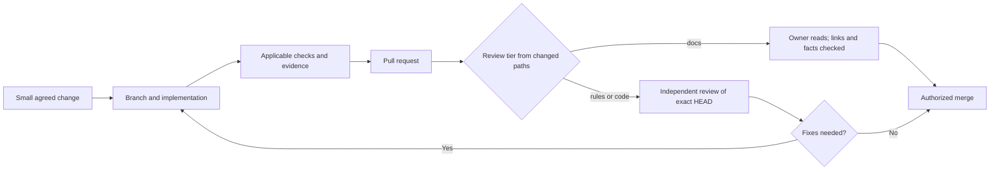

# Contributing to Kriptofolio

Start with [AGENTS.md](AGENTS.md) for protected historical branches, development commands,
data safety and release restrictions. It is the canonical project instruction for people and agents.
You do not need a private method repository, paid playbook or the author's review service to contribute.

1. Agree on a small change and its acceptance criteria. Preserve the original tutorial branches.
2. Create a separate branch and working copy from the intended target branch. Do not mix another
   contributor's work into the change.
3. Implement the change and run the applicable build and test commands from `AGENTS.md` with
   the documented JDK 21 and a configured Android SDK. Keep the exact commands, toolchain,
   actual results and any checks you could not run in the pull request. The two narrow lint
   exceptions and their reasons are in `app/lint.xml`; do not add a baseline. Documentation-only
   evidence should check the instructions and links, without claiming an Android build was run.
4. Open a pull request with the problem, resulting behavior, evidence and remaining limitations.
5. Check the pull request's review tier. The paths it changes decide the tier, and the
   [review tier workflow](.github/workflows/review-tier.yml), which holds the exact path lists,
   shows it as a label:
   - **`review: docs`**: only documentation that is not a rule: Markdown in the repository root
     (such as `README.md`), files under `docs/`, and store listing texts and images. Markdown
     anywhere else, for example inside the app or its tests, counts as code. No independent
     review is needed: the evidence checks the links and facts, `git diff --check` is clean, and
     the owner reads the change before merging.
   - **`review: rules`**: any file that instructs people and agents or defines the contract and the
     plan: `AGENTS.md`, `CLAUDE.md`, `CONTRIBUTING.md` and the license files `LICENSE`, `LICENSE.md`
     and `LICENSE.txt` at any depth and in any letter case (a new agent instruction file is added to
     this list and to the workflow in the same pull request), `RELEASING.md`, `UPGRADE-NOTES.md`,
     `SUPPORT.md`, `renovate.json`, `config/`, `.github/`, `.claude/`, `docs/decisions/`,
     `docs/roadmap.md`, `docs/execution-plan.md`, `docs/BEHAVIOUR.md`, `docs/behaviour-parity.md`,
     `docs/ui-inventory.md` and the captures in `docs/ui-evidence/`.
   - **`review: code`**: anything else. A pull request that mixes tiers takes the strictest one,
     and one too large to list completely counts as code.

   For `rules` and `code`, ask a teammate or a fresh agent session to review the exact HEAD using
   the target branch's [review rules](config/review-rules.md), or, as a maintainer, comment
   `/simple-review` (see "Automated review" below). Record the reviewed SHA, concrete findings and
   scope. Automated review is optional; absence of a bot is not a passing review.
   A label never lowers what the paths require; if the label is missing or wrong, the paths decide.
6. Fix findings, rerun relevant checks and, for `rules` and `code`, review the new revision. Merge
   requires authorization; signing and publishing an application release remain separate actions.

## Automated review

Maintainers with write access can comment `/simple-review` on a pull request. The
[workflow](.github/workflows/simple-review.yml) reads the pull request, its diff, the changed files
at HEAD, and `AGENTS.md` and `config/review-rules.md` from the base branch through the API. It never
checks out or runs the pull request's code. It updates one comment with the reviewed HEAD and BASE,
the findings and an X/5 verdict, and keeps earlier findings across rounds until they are resolved.

- A result counts as the independent review of step 5 when it names the exact HEAD. On this path
  the bar is **5/5 with no open findings**; a lower score or "no conclusion" is not a pass, so fix
  the findings, push and comment `/simple-review` again. A reviewer session or a teammate passes a
  pull request when it reports no unresolved Issues under `config/review-rules.md`.
- A passing review is not merge approval. The build and tests must still be green, and the merge
  stays the owner's decision.
- What is sent to the model provider of the configured engine: the pull request's title and body,
  the diff, the changed files at HEAD, the full HEAD content of any other file named in an open
  finding of an earlier round, `AGENTS.md` and the review rules from BASE, the findings of the
  previous round, and up to 8 line ranges of at most 400 lines from any file at HEAD that the model
  asks for. With the default engine that provider is the owner's Claude subscription, through the
  `CLAUDE_CODE_OAUTH_TOKEN` repository secret (created with `claude setup-token`).
- The comment must be exactly `/simple-review`, with nothing else in it. Without the secret, or
  with a wrong engine setting, the run fails in the Actions tab and posts no comment.
- Optional repository variables: `SIMPLE_REVIEW_MODEL` (default `claude-opus-5-5`),
  `SIMPLE_REVIEW_EFFORT` (default `high`), `SIMPLE_REVIEW_TIMEOUT_SECONDS` (default `600`),
  `SIMPLE_REVIEW_RULES` (default `config/review-rules.md`), `SIMPLE_REVIEW_MAX_DIFF_BYTES`
  (default `120000`), `SIMPLE_REVIEW_MAX_CONTEXT_BYTES` (default `200000`), and
  `SIMPLE_REVIEW_ENGINE` with `SIMPLE_REVIEW_API_URL` and the secret `SIMPLE_REVIEW_API_KEY` for an
  OpenAI-compatible API.
- Contributors without the secret use a teammate or a fresh agent session instead; nothing in this
  repository requires the automated review.

The public repository is the source of application code and reproducible project evidence.
Any educational product built around it is separate and does not grant merge or release permission.
