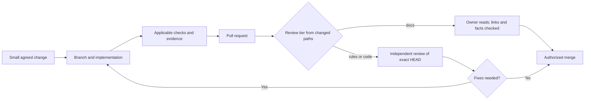

# Contributing to Kriptofolio

Start with [AGENTS.md](AGENTS.md) for protected historical branches, development commands,
data safety and release restrictions. It is the canonical project instruction for people and agents.
You do not need a private method repository, paid playbook or the author's review service to contribute.

1. Agree on a small change and its acceptance criteria. Preserve the original tutorial branches.
2. Create a separate branch and working copy from the intended target branch. Do not mix another
   contributor's work into the change.
3. Implement the change and run the applicable build and test commands from `AGENTS.md` with
   the documented JDK 21 and a configured Android SDK. Keep the exact commands, toolchain,
   actual results and any checks you could not run in the pull request. The two narrow lint
   exceptions and their reasons are in `app/lint.xml`; do not add a baseline. Documentation-only
   evidence should check the instructions and links, without claiming an Android build was run.
4. Open a pull request with the problem, resulting behavior, evidence and remaining limitations.
5. Check the pull request's review tier. The paths it changes decide the tier, and the
   [review tier workflow](.github/workflows/review-tier.yml), which holds the exact path lists,
   shows it as a label:
   - **`review: docs`**: only documentation that is not a rule: Markdown in the repository root
     (such as `README.md`), files under `docs/`, and store listing texts and images. Markdown
     anywhere else, for example inside the app or its tests, counts as code. No independent
     review is needed: the evidence checks the links and facts, `git diff --check` is clean, and
     the owner reads the change before merging.
   - **`review: rules`**: any file that instructs people and agents or defines the contract and the
     plan: `AGENTS.md` and `CLAUDE.md` at any depth and in any letter case (a new agent instruction
     file is added to this list and to the workflow in the same pull request), `CONTRIBUTING.md`,
     `RELEASING.md`, `UPGRADE-NOTES.md`, `SUPPORT.md`, `LICENSE`, `renovate.json`, `config/`,
     `.github/`, `.claude/`, `docs/decisions/`, `docs/roadmap.md`, `docs/BEHAVIOUR.md`,
     `docs/behaviour-parity.md`, `docs/ui-inventory.md` and the captures in `docs/ui-evidence/`.
   - **`review: code`**: anything else. A pull request that mixes tiers takes the strictest one.

   For `rules` and `code`, ask a teammate or a fresh agent session to review the exact HEAD using
   the target branch's [review rules](config/review-rules.md). Record the reviewed SHA, concrete
   findings and scope. Automated review is optional; absence of a bot is not a passing review.
   A label never lowers what the paths require; if the label is missing or wrong, the paths decide.
6. Fix findings, rerun relevant checks and, for `rules` and `code`, review the new revision. Merge
   requires authorization; signing and publishing an application release remain separate actions.

The public repository is the source of application code and reproducible project evidence.
Any educational product built around it is separate and does not grant merge or release permission.
